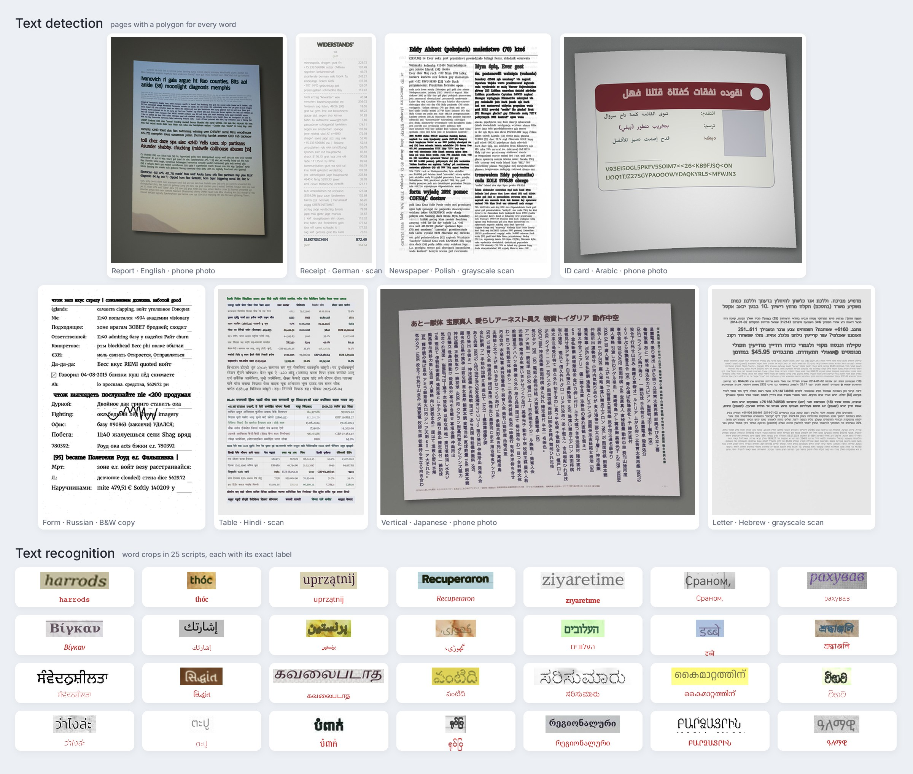

[](LICENSE)

[](https://codecov.io/gh/felixdittrich92/docTR-Synth-Generator)
[](https://www.codefactor.io/repository/github/felixdittrich92/doctr-synth-generator)
[](https://pypi.org/project/docTR-Synth-Generator/)

# docTR-Synth-Generator

Synthetic training data for [docTR](https://github.com/mindee/doctr): word crops for
**text recognition** and full document pages with word polygons for **text detection**,
in ~100 languages and 24 scripts.



- **Zero-config** - real words, matching fonts and paper backgrounds are downloaded and cached on first use.
- **Labels that match the pixels** - every word is shaped with HarfBuzz before a font is used for it, so no
  crop shows a tofu box, a dotted circle or an empty glyph its label doesn't mention.
- **Complete vocab coverage** - every character of the docTR vocab you train on appears in train *and* val.
- **Realistic documents** - paragraphs, newspapers, forms, tables, receipts, ID cards and vertical CJK text
  on real paper sizes, with photos, stamps, handwriting, barcodes and punch holes; folded or crumpled;
  scanned in colour, grayscale or black-and-white, or photographed on tablecloths and tables (bent sheets,
  perspective, uneven light, shadows, colour casts).
- **Hard negatives** - unlabelled show-through from the back of the sheet, and pages with no text at all
  (creased blank paper, fabric, wood, empty forms, graphics), so a detector learns what is *not* text.
- **Crops like a detector cuts them** - recognition crops carry real margins and the cut-off edges of
  neighbouring lines and table rules, as crops from real pages do.
- **docTR-ready** - writes the folder layout docTR's training scripts read, or plugs into them on the fly.

## Installation

```bash
pip install doctr-synth-generator
```

Arabic, Hebrew and the Indic and South-East Asian scripts need a Pillow build with **libraqm**
(`python -c "from PIL import features; print(features.check('raqm'))"` must print `True`).
On Debian/Ubuntu: `apt install libraqm0 libfribidi0`.

## Quickstart

```python
from generator import generate_dataset

# 10k recognition crops (English by default)
generate_dataset("rec_dataset", num_images=10_000)

# several languages - words, fonts and shaping are resolved per language code
generate_dataset("rec_dataset", num_images=10_000, languages=["en", "de", "ru", "ar", "hi"])

# 2k detection pages
generate_dataset("det_dataset", num_images=2_000, task="detection", languages=["en", "de"])
```

The same from the command line:

```bash
doctr-synth rec_dataset -n 10000 -l en de ru ar hi
doctr-synth det_dataset -n 2000 -t detection -l en de --layout form
```

Each split is written as `images/` + `labels.json` in docTR's format, so it trains as is:
`--train_path rec_dataset/train --val_path rec_dataset/val`.

## Configuration

Every keyword of `generate_dataset()` is a configuration option. For full control build the
config yourself - flat names are routed into the right sub-config:

```python
from generator import GenerationConfig, SyntheticDatasetGenerator

cfg = GenerationConfig.flat(
    output_dir="det_dataset",
    task="detection",
    num_images=5_000,
    languages=["en", "fr"],
    det_layout="newspaper",
    capture_prob=0.5,
    output_jpeg=True,
    num_workers=8,
)
SyntheticDatasetGenerator(cfg).generate_dataset()
```

The options you are most likely to change:

| Option | Default | What it does |
| --- | --- | --- |
| `task` | `"recognition"` | `"recognition"` crops or `"detection"` pages |
| `num_images` / `val_percent` | `1000` / `0.2` | total samples and the validation **fraction** (`0.15`, not `15`) |
| `languages` | `["en"]` | ISO 639-1 codes; select words, fonts and script shaping |
| `target_vocab` | `None` | recognition: restrict labels to a docTR `VOCABS` key or list, e.g. `["german", "urdu"]` |
| `num_workers` / `output_jpeg` | `4` / `False` | parallel processes, JPEG instead of PNG |
| `font_size_range` | `(12, 40)` | recognition: crop text size in pixels |
| `det_layout` | `"mixed"` | `paragraph`, `newspaper`, `form`, `id_card`, `vertical`, `table`, `receipt` or `mixed` |
| `det_vertical_prob` | `0.2` | chance a horizontal page also carries vertical text |
| `det_partial_page_prob` | `0.25` | chance a page ends part-way down, like the last page of a letter |
| `det_furniture_prob` | `0.3` | headers, page numbers, stamps, logos, barcodes, signatures |
| `det_handwriting_prob` | `0.35` | chance a form or receipt value is hand-written |
| `det_picture_prob` | `0.3` | chance a paragraph or newspaper page carries a photo with a caption |
| `det_crease_prob` | `0.2` | chance a sheet is folded or crumpled (receipts more often) |
| `det_bleed_through_prob` | `0.25` | chance the back side shows through as light, unlabelled text |
| `capture_prob` | `0.35` | chance a page is photographed (perspective, shadow, lighting) rather than scanned |
| `capture_curl_prob` | `0.6` | chance a photographed sheet is bent, so its text lines bow |
| `capture_textured_surface_prob` | `0.65` | chance a photographed sheet lies on fabric, wood or crumpled paper |
| `grayscale_prob` / `bitonal_prob` | `0.3` / `0.08` | crops and pages delivered in grayscale or black-and-white (fax, copier, scanner apps) |
| `context_prob` | `0.35` | recognition: crop margins show cut-off neighbouring lines or table rules |
| `media_dpi_range` | `(150, 300)` | scan resolution of the physical page |
| `min_local_contrast` | `30.0` | recognition: re-draw a crop until every part of the word is readable |
| `language_balance` | `"balanced"` | `"balanced"` or `"proportional"` split across languages |
| `wordlist_path` / `font_dir` / `bg_image_dir` | `None` | use your own words, fonts or backgrounds instead of the downloads |

All options are documented in [`generator/components/config.py`](generator/components/config.py);
any field there works as a flat keyword (detection fields take a `det_` prefix, capture `capture_`,
media `media_`).

## Large-scale datasets

For millions of samples use the recipes. They build datasets in resumable shards, vet every
font, and guarantee vocab coverage:

```bash
# recognition - Latin, Cyrillic and Greek (66 languages)
python -m generator.recipes.recognition prepare --languages european --out european_rec
python -m generator.recipes.recognition preview --out european_rec   # look before you render
python -m generator.recipes.recognition render  --out european_rec   # resumable
python -m generator.recipes.recognition verify  --out european_rec   # every vocab character rendered?

# detection - pages in ~100 languages
python -m generator.recipes.detection prepare --languages all --out multilingual_det
python -m generator.recipes.detection render  --out multilingual_det
```

`--languages` takes `european`, `multilingual` (every non-CJK vocab: 96 languages) or `all`, or
codes such as `de,fr,ru`. `--num-train`, `--num-val` and `--min-char-count` set the size and the
per-character floor. Recognition: `--handwriting-share` (default `0.05`) writes crops in one of ~40
handwriting faces (Latin, Cyrillic, Greek, Arabic, Hebrew, Thai, Indic, CJK, Korean). Detection:
`--density` (`mixed` by default: 50% letters, 30% reports, 20% broadsheet-dense pages with up to ~3000
words) and `--negative-share` (default `0.05`, pages without text). Train with docTR as usual:

```bash
python references/recognition/train.py crnn_vgg16_bn --train_path european_rec/train --val_path european_rec/val ...
python references/detection/train.py db_resnet50 --train_path multilingual_det/train --val_path multilingual_det/val --rotation ...
```

Pass `--rotation` for detection: photographed and skewed pages carry rotated polygons, and without it
docTR turns them into loose straight boxes. For dense pages a larger `--input_size` (e.g. `1536`)
keeps small newspaper text above a few pixels.

Each `shard_XXXX/` folder under `train/` is picked up by docTR's recognition script. The model vocab
is written to `meta/vocab.txt`: add it to docTR's `VOCABS` under a name and pass that name as `--vocab`.
How the recipes keep each image and its label in agreement:

- The model vocab is what the vetted fonts can actually draw; anything else is reported in
  `meta/vocab_dropped.json` instead of becoming a class no image contains.
- A font is used for a language only if it draws every letter that occurs in that language.
- Every vocab character reaches at least `--min-char-count` train labels (default 1000) - real words
  first, symbols in real contexts (`R&D`, `25°C`, `C:\Users`), synthetic tokens only as a fallback.
- `verify` recounts the labels that were actually written, and `topup` renders whatever is short.
- Validation shares no word with training, and words that look identical in another script
  (Cyrillic `се` vs Latin `ce`) are left out.

## Train on the fly

Skip the disk entirely: `build_recognition_datasets` / `build_detection_datasets` return PyTorch
datasets that render a fresh sample on every access and drop into docTR's training scripts in
place of `RecognitionDataset` / `DetectionDataset`:

```python
from generator import GenerationConfig, build_recognition_datasets, synth_worker_init_fn

cfg = GenerationConfig.flat(task="recognition", num_images=100_000, val_percent=0.1)
train_set, val_set = build_recognition_datasets(cfg, vocab="french", img_transforms=img_transforms)

train_loader = DataLoader(
    train_set,
    batch_size=64,
    shuffle=True,
    num_workers=8,
    collate_fn=train_set.collate_fn,
    worker_init_fn=synth_worker_init_fn,
)
```

Pass the vocab your model trains on: every label is restricted to it. For detection use
`build_detection_datasets(cfg, languages=["en", "de"], use_polygons=True)`. Requires PyTorch
(`pip install python-doctr`).

## Development

```bash
pip install -e ".[dev]"
make test      # offline test suite + coverage
make quality   # ruff + mypy
make style     # format and auto-fix
```

To regenerate the image at the top, prepare one detection and one recognition build and run
`python scripts/generate_grid.py --det <det build> --rec <rec build> -o docs/examples.jpg` (see the script for the languages it expects).

## Citation

```bibtex
@misc{docTR-Synth-Generator,
    title={docTR-Synth-Generator: A tool to generate synthetic OCR text datasets - made for docTR},
    author={{Dittrich, Felix}},
    year={2026},
    publisher = {GitHub},
    howpublished = {\url{https://github.com/felixdittrich92/docTR-Synth-Generator}}
}
```

Word lists come from [FrequencyWords](https://github.com/hermitdave/FrequencyWords) and
[most-common-words-multilingual](https://github.com/frekwencja/most-common-words-multilingual), fonts
from [Google Fonts](https://fonts.google.com) and the [fonts_v1](https://github.com/felixdittrich92/docTR-Synth-Generator/releases/download/v0.0.1/fonts_v1.zip)
release; please respect their licenses when redistributing generated datasets.

## License

Distributed under the Apache 2.0 License. See [`LICENSE`](LICENSE) for more information.
